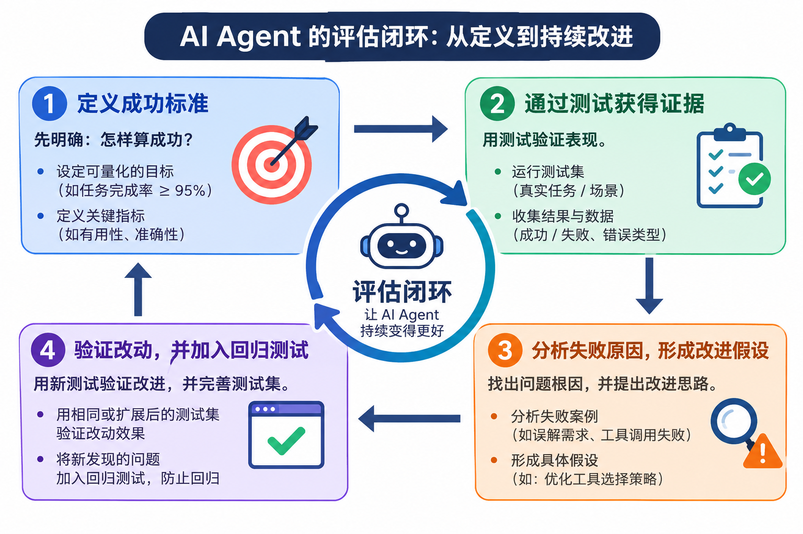
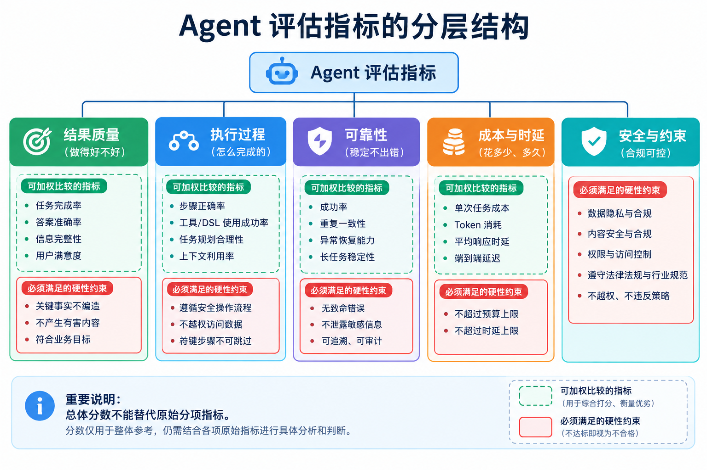
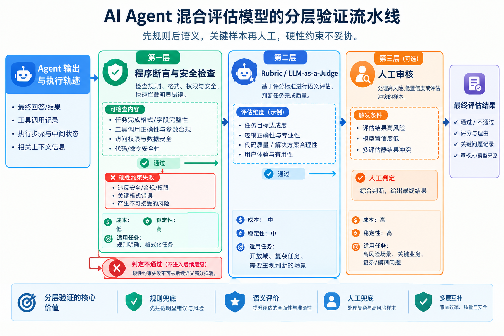
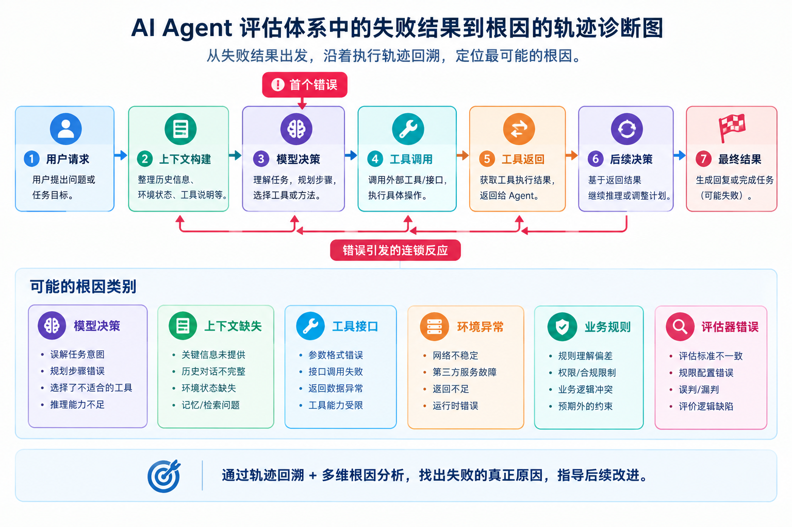
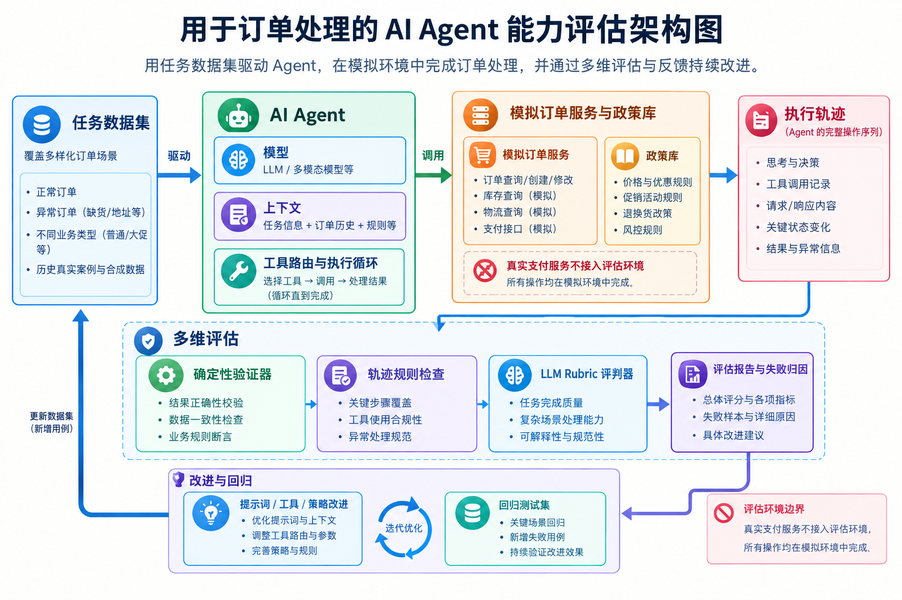

# 第5章 Agent 的评估：从能力度量到系统改进

前面的章节讨论了如何构建一个 Agent：怎样组织输入，怎样连接外部工具，怎样保存和检索信息。但一个系统能够运行，并不意味着它能可靠地完成任务；一次演示成功，也不代表它在不同输入、异常情况和真实业务环境中都能成功。

因此，本章把重点从“构建能力”转向“验证能力”。我们要回答几个相互关联的问题：什么样的结果才算成功？怎样设计一组有代表性的评估任务？由程序、模型还是人工来判断结果？如果 Agent 失败了，如何定位原因？最后，又怎样让评估结果真正推动系统改进？

本章的逻辑主线是：**定义成功标准 → 构建评估任务与环境 → 选择验证方法 → 执行实验并分析结果 → 定位失败原因 → 形成持续改进闭环。** 每一步都以前一步为基础。

本章所聚焦的评估对象不是孤立的模型，而是**模型与运行框架（Harness）的组合**。本章不深入讲解模型训练、奖励模型训练或多 Agent 协作算法；这些主题可以复用本章建立的评估方法，但不属于本章的主要边界。

> **图5-1：Agent 评估的完整闭环**  
> 图片要求：绘制一个从左向右、末端回环到起点的流程图。依次包含“业务目标与成功标准”“评估任务与环境”“运行 Agent”“验证与评分”“轨迹分析与失败归因”“提出改进假设”“对照实验与回归测试”。在“回归测试”之后用箭头回到“评估任务与环境”，标出评估集持续更新。图中强调评估不是一次性的测验，而是贯穿开发和迭代的工程过程。


## 5.1 为什么 Agent 需要评估

**本节目标**

明确评估在 Agent 开发中的作用，以及 Agent 评估与传统软件测试之间的联系和差异。本节只建立概念框架，不展开具体指标、数据集格式或验证器实现；这些内容分别放在后续章节讨论。


### 5.1.1 从“看起来能用”到“能够可靠交付”

Agent 的演示通常容易让人产生过度乐观的判断。给它一个任务，它成功完成了；再换一个类似任务，它可能遗漏一个步骤、选错工具，或者在遇到异常后陷入重复尝试。单次成功只能说明系统在这一种输入和执行轨迹下完成了任务，无法说明它具备稳定的能力。

可以把 Agent 想象成一名新员工。让他成功处理一张报销单，并不能证明他已经理解所有报销规则；还需要测试重复提交、发票缺失、金额超限、审批权限不足等情况。Agent 评估也是如此：既要看常见任务能否完成，也要检验边界条件、失败恢复、资源限制和安全约束。

评估首先要把“感觉不错”转化为可量化、可检查的证据。例如，客服 Agent 不应只因回答语气自然就被判定为成功，还需要确认它是否查对订单、是否遵守退款规则、是否真正完成了退款操作，以及是否准确告知用户结果。不同场景的成功条件不同，评估必须跟业务目标绑定。


### 5.1.2 评估对象：模型、Harness 与完整执行链路

Agent 的最终表现通常由多个因素共同决定：模型的理解与推理能力、系统提示词、上下文组织方式、工具的可用性、记忆与检索结果、执行循环、错误处理和权限约束。运行框架（Harness）是指围绕模型搭建的这套控制与执行机制，包括何时调用模型、怎样传递工具结果、如何管理状态以及何时停止任务。

因此，不能简单地把“Agent 失败”理解为“模型不够聪明”。假设一个文件操作 Agent 没有修改正确的文件，原因可能是模型理解错了需求，也可能是文件搜索工具返回的信息不完整，还可能是 Harness 没有把工具报错交还给模型处理。只看最终结果，无法区分这些原因。

评估时可以采用两类互补实验：一是**模型替换实验**，固定提示词、工具和执行框架，只替换模型，观察结果变化；二是**消融实验**，保持其他条件尽量一致，关闭或替换某个组件，观察性能如何变化。前者帮助判断能力瓶颈更偏向模型还是系统框架，后者帮助判断某个组件是否确实贡献了价值。两种实验都不能单独给出全部答案，但能让改进决策建立在证据之上。


### 5.1.3 Agent 评估与传统软件测试的区别

传统软件测试经常面对输入、输出和预期结果相对明确的函数。例如，输入两个整数，检查函数是否返回正确的和。Agent 则通常具有多个决策步骤：它会选择工具、解释工具返回、调整计划，并根据执行状态决定下一步行动。即使最终结果相同，执行轨迹也可能完全不同。

此外，模型输出具有一定随机性，外部环境可能变化，开放式任务的“正确答案”也未必只有一个。因此，Agent 评估不能只依赖单个测试样例或字符串比较，而需要综合最终状态、关键步骤、过程约束、可靠性、成本和用户体验等证据。

这并不意味着 Agent 不适合使用传统测试。相反，能确定性检查的部分应该尽量使用断言、单元测试和集成测试。只有在结果难以机械判断的地方，才需要引入评分量表、模型评判或人工审核。一个成熟的评估体系，是软件测试、实验方法和语义质量判断的组合，而不是用一种方法包打天下。


### 5.1.4 建立评估闭环：度量、诊断、改进与回归

一般来说，评估的完整流程包含四个阶段：先定义怎样算成功，再通过测试获得证据；接着分析失败的原因，形成具体的改进假设；最后用相同或扩展后的测试集验证改动，并将新发现的问题加入回归测试。

例如，若 Agent 在一组数据库操作任务上的成功率偏低，团队不应立即更换模型，而应先查看失败样例：是查询条件抽取错误、工具选错、调用参数不合法，还是操作成功却没有向用户解释结果？如果多数失败都来自参数格式，那么改进工具描述或参数校验可能比换一个更大的模型更直接。




## 5.2 评估什么：指标与成功标准

**本节目标**

把业务目标转化为可验证的成功条件，并建立一套能反映结果、过程、可靠性、成本和安全性的指标体系。本节讨论“测量什么”，不规定评估任务必须采用哪一种数据格式；任务与环境的组织方式将在 5.3 介绍。


### 5.2.1 从业务目标到可验证的任务成功条件

指标设计的起点是明确用户真正需要什么。一个常见错误是用容易统计的代理指标替代真正目标。例如，以“工具调用成功”代表“任务成功”，但也要注意工具成功返回并不意味着选对了记录；以“回复长度”代表“解释充分”，也无法保证回复准确。

可以把每个评估任务的成功条件拆成三层：

1. **结果条件：** 最终状态是否达到目标。例如订单状态已退款、目标文件包含指定修改、知识问题回答正确。
2. **过程条件：** 是否遵循必要步骤。例如高风险删除前是否确认、是否读取必要的规则文件、是否在信息不足时询问用户。
3. **约束条件：** 是否避免不可接受的行为。例如没有泄露秘密、没有越权访问、没有伪造执行结果。

并非每个任务都需要三层条件，但必须明确哪些是硬性要求，哪些只是质量偏好。硬性条件不应被其他维度的高分抵消：即使答案流畅、任务大体完成，只要发生了严重越权，就不能简单以加权平均判定整体合格。


### 5.2.2 结果指标：任务成功率与部分完成度

最直观的指标是**任务成功率**：在评估集的所有任务中，有多少任务通过验收。若 100 个任务有 82 个通过，成功率就是 82%。为了保证这个比例有意义，必须先明确“通过”的口径，并保持各次实验的口径一致。

但二元成功率会丢失部分信息。一个任务可能已经完成 90%，只差最后一步确认；另一个任务可能完全误解了目标。两者都记为失败，不利于诊断。因此，可以为复杂任务设置分项得分，例如将任务拆成“需求理解、证据收集、关键操作、结果校验、用户反馈”等步骤，并分别统计完成情况。

分项得分适合分析改进方向，但不应随意替代最终成功率。团队应同时报告严格的任务通过率和可解释的过程分项，避免 Agent 在中间步骤得分不错，却始终不能交付用户需要的结果。


### 5.2.3 过程指标：工具调用、执行效率与任务完成质量

Agent 的过程指标帮助理解它是怎样完成任务的。常见指标包括工具调用成功率、无效或重复调用次数、平均执行步数、重试次数、关键步骤覆盖率、澄清问题的适当性，以及是否正确处理工具错误。

这些指标需要结合场景解释。工具调用次数少，不一定代表效率高：如果 Agent 因为没有收集必要信息而过早作答，少调用工具反而是缺陷。调用次数多，也不必然意味着低效：复杂调研任务可能需要多次搜索和交叉验证。更合理的判断方式是比较同类任务的完成质量与资源消耗，并检查是否存在可避免的步骤。

可以将过程指标分为诊断指标与目标指标。诊断指标用来解释系统行为，例如“重复搜索次数”；目标指标直接关系到业务价值，例如“在不违反政策的前提下完成退款”。诊断指标有助于找到问题，但不应成为唯一优化目标。


### 5.2.4 可靠性指标：Pass@k 与连续成功率

Agent 的单次表现可能受到模型采样、工具返回和环境状态影响。对于可反复尝试的探索任务，开发者可能关心“运行多次，至少有一次成功”的概率，这类指标通常写作 **Pass@k**。如果每次成功率为 `p`，且各次尝试近似独立，那么至少一次成功的概率为：

$$
\mathrm{Pass@k}=1-(1-p)^k
$$
但生产业务往往更关心稳定性：同一类任务连续执行时，能否每次都不出错。若仍假设每次独立、单次成功率为 `p`，连续 `k` 次都成功的概率为：

$$
\mathrm{Pass}^{k}=p^k
$$
例如，单次成功率为 0.8 时，连续 5 次至少成功一次的概率约为 99.97%，但连续 5 次全部成功的概率只有约 32.8%。两者表达的是不同问题：Pass@k 更接近探索能力上限，连续成功率则更接近高可靠业务对稳定交付的要求。

这里的独立性假设在真实系统中未必成立，因此公式主要用于建立直觉。评估报告应明确 `k` 的含义、任务是否重复，以及每次运行是否使用相同初始状态。对于支付、删除或发布等有副作用的任务，不应在真实生产环境里为了统计成功率而反复执行，应使用可重置的沙盒、模拟环境或可靠的回滚机制。


### 5.2.5 成本与时延：Token 消耗、执行时间与单位任务成本

Agent 的运行成本往往不止一次模型调用。一个任务可能包含多轮推理、工具调用、上下文反复传递和失败重试。仅比较模型每百万 Token 的单价，容易忽略便宜模型因频繁失败而产生的额外调用，也容易忽略强模型因为执行更快、重试更少而带来的总体收益。

建议至少记录：每个任务的输入与输出 Token 数、模型调用次数、工具调用次数、端到端执行时间，以及实际 API 或基础设施成本。延迟可以报告平均值，也应报告 p50、p95 等分位数。p95 表示 95% 的请求耗时不超过该值，它能揭示少数特别慢的请求，而平均值可能会把这类问题掩盖掉。

比较方案时应采用“完成同类任务的总成本”，而不是只比较单次调用费用。一个实用问题是：为了把成功率提高一个百分点，需要增加多少成本和时延？当收益不值得额外开销时，更复杂的方案未必适合默认启用，可以只在高风险或高价值任务中调用。


### 5.2.6 安全与约束：错误操作、越权行为及合规性

安全指标通常不能仅靠平均分表达。许多系统需要设置**一票否决项**：一旦出现严重违规，任务就判定为失败，无论其他维度分数多高。典型检查包括越权调用、泄露受保护信息、未经确认执行高风险操作、绕过业务规则，以及声称执行成功但实际上没有证据。

安全评估还要覆盖拒绝和澄清能力。Agent 不应对所有请求都积极执行：当权限不足、要求含糊或操作不可逆时，正确的行为可能是拒绝、询问补充信息，或先提供预览等待用户确认。因此，不能把“完成更多任务”简单当作唯一目标；要判断它是否在允许的边界内完成了任务。


### 5.2.7 多维指标的权衡：综合评分与硬性门槛

单一分数容易隐藏重要差异。两个方案可能都得 85 分，但一个在准确率上更高、成本也更高；另一个更便宜，却更容易发生安全问题。报告应先展示关键指标的独立结果，再决定是否需要综合评分。

如果确实需要综合得分，可以将任务成功率、过程质量、成本和延迟按照明确权重进行汇总。但权重必须反映真实业务优先级，不能仅为了方便排名而随意设定。对安全、隐私和合规等底线，更适合采用门槛或否决规则，而不是当作普通加分项。




## 5.3 如何构建评估任务与评估环境

**本节目标**

说明如何把真实需求整理成稳定、可复现、可覆盖不同难度的测试任务，并搭建适合反复执行的环境。本节关注评估对象和运行条件的设计。


### 5.3.1 评估任务的基本结构

一条可用的评估任务至少应包含以下内容：

- **任务输入：** Agent 实际能看到的用户请求、文件、上下文或其他输入。
- **初始状态：** 运行开始时数据库、文件系统、浏览器、设备或业务对象所处的状态。
- **可用能力：** Agent 能访问哪些工具、权限和外部资源。
- **交互协议：** 任务如何继续、何时结束、超时或失败时怎样处理。
- **成功条件：** 完成后应检查什么结果，以及哪些行为是禁止的。

这些信息应尽量明确地表达，避免把评分者的主观猜测留到任务结束后。例如，“帮助用户处理退款”太模糊；“订单符合退款条件，退款金额与原支付金额一致，订单状态更新为已退款，并向用户说明处理结果”则更便于验证。

还应区分 Agent 可见信息与评估器掌握的信息。Agent 不应直接读取隐藏的标准答案或内部验收状态，否则评估就变成了泄漏答案的游戏。验收条件由独立的评估器保存，仅在任务结束后或必要的检查点执行。


### 5.3.2 评估数据集的来源：公开 Benchmark、业务任务与生产失败案例

评估集通常来自三类来源。第一类是公开 Benchmark，它适合了解通用能力、学习成熟的任务设计方式，以及粗略筛选候选方案，但它的任务分布未必符合实际产品。公开榜单上的提升，不能自动转化为自己的业务收益。

第二类是自建业务评估集。它应覆盖产品中的常见任务、关键任务和高风险场景，任务内容、工具接口和验收标准尽可能贴近真实使用。即使初期只有几十个精心设计的任务，也比完全凭感觉比较版本更有价值。随着系统发展，评估集还应扩充难例和边界案例。

第三类是生产失败案例回流。线上出现用户纠正、负面反馈、状态异常或审计发现的问题后，团队应在去除敏感信息并完成归因后，将问题整理成可重复运行的回归任务。这类任务最贴近真实产品，也经常暴露人工预先设计时想不到的问题。

三类来源各有作用：公开 Benchmark 用于外部参照，自建业务集用于内部决策，生产失败集用于防止已知问题反复发生。它们应形成互补，而不是互相替代。


### 5.3.3 任务覆盖与难度分层

评估集不应只包含容易成功的“展示型任务”。一个实用的设计方式是按任务难度与风险分层：

- **基础任务：** 单步查询、清晰指令、工具返回正常。
- **组合任务：** 多步骤执行，需要综合多个工具结果或维护中间状态。
- **歧义任务：** 用户信息不完整、目标不明确，正确行为可能是澄清。
- **异常任务：** 工具超时、返回错误、数据缺失或执行被中断。
- **边界与安全任务：** 权限不足、规则冲突、不可逆操作或可能触发越权行为。

除了难度，还应为任务设置能力标签，例如信息检索、规划、参数构造、状态追踪、错误恢复和用户沟通。这样，当某个版本在整体指标上退步时，就可以继续追问：究竟是哪一类任务退化了？

评估集覆盖度不等于样例越多越好。大量重复的简单任务未必能增加多少信息；一些高质量边界案例反而能更快暴露系统缺陷。初期可以先保证任务类型和失败模式覆盖，再逐步增加规模。


### 5.3.4 评估环境的设计：状态初始化、工具接口、执行协议与隔离机制

同一个任务如果每次从不同状态开始，结果就难以公平比较。环境应提供明确的初始化流程，使每次执行前都能恢复到已知状态。例如，测试退款时需要准备固定订单、用户权限和退款记录；测试文件编辑时，需要恢复初始仓库、分支和工作区。

工具接口应尽量接近 Agent 在目标产品中实际使用的接口，同时保持验证所需的可控性。工具粒度也很重要：如果环境只提供一个“完成整个任务”的高层函数，评估测到的可能只是单次函数调用，而不是 Agent 的规划和工具选择能力。反过来，接口太底层、与实际产品完全不同，也会让评估失去代表性。

执行协议需要明确最大运行步数、超时、终止条件、重试规则以及工具错误的处理方式。对会修改外部状态的操作，应该优先使用沙盒、模拟服务、测试账号或可回滚环境，避免评估造成真实损失。环境隔离还应防止不同任务之间共享不该共享的文件、对话、缓存或记忆状态。


### 5.3.5 不同任务的环境选择

任务形态不同，环境设计也应不同。单轮问答通常只需输入和答案验证；多轮搜索任务需要记录工具与上下文变化；数据库操作任务必须跟踪状态是否真正改变；代码生成任务需要隔离的文件系统和测试运行环境；模拟用户服务任务则需要用户模拟器与 Agent 双方的交互协议。

可以用两个问题来选择环境：第一，任务是否需要跨步骤保存状态？第二，执行是否需要隔离？如果不需要跨轮状态，可以采用较轻量的单轮环境；如果需要修改文件、数据库或 UI，就应使用有状态环境；如果要执行不可信代码或具有副作用的操作，则需要沙盒或可恢复环境。

对于交互式任务，用户模拟器尤其需要注意信息边界。模拟用户应只知道真实用户在当前时刻能够知道的信息，而不应因为它参与了评估就把隐藏答案主动告诉 Agent。否则，测试出来的可能是“Agent 在信息完整时能否操作”，而不是“Agent 能否通过对话获取所需信息”。


### 5.3.6 评估集的质量管理：数据泄漏、测试污染与长期维护

如果评估答案泄漏到了提示词、示例或训练数据中，分数就不能真实反映泛化能力。这类问题称为数据泄漏或测试污染。规避方法包括将测试集与日常开发样例分开管理、限制隐藏测试集的访问、定期加入新案例，以及监控是否出现不合理的异常高分。

评估数据还要随着产品变化持续维护。业务政策、工具接口和数据结构可能发生改变，旧任务因此失去有效性。每个任务应有明确的版本、来源、适用环境和预期行为；当任务失效时，要记录原因，而不是静默删除失败用例。

还应防止只保留能够通过的案例。评估集的目标不是证明当前版本很好，而是帮助团队发现它在哪里还不够好。已知失败案例即使令分数下降，也应在问题修复并确认案例仍具代表性之前保留下来。

#### 实验5-3：搭建可重置的评估环境

**实验目的：** 验证同一用例在多次运行中具有可比性，并确认评估环境不会把隐藏答案泄漏给 Agent。
**实验方式：** 为一个简单的订单或文件编辑任务编写初始化脚本、工具接口、终止协议与验收函数。连续运行同一任务多次，比较初始状态和验收结果；再故意跳过状态重置，观察结果为何可能受到前一次运行的影响。

```python
# -*- coding: utf-8 -*-
"""
实验：搭建可重置的评估环境

实验目的：
  1. 验证同一用例在多次运行中具有可比性（初始状态一致、验收结果一致）。
  2. 确认评估环境不会把隐藏答案泄漏给 Agent。
  3. 故意跳过状态重置，观察上一轮运行如何污染下一轮的结果。

运行方式：
  python eval_env_experiment.py                  # 使用固定策略 Agent（无需 LLM，结果可复现）
  python eval_env_experiment.py --agent llm      # 使用本地 llama.cpp 服务中的模型作为 Agent

依赖：
  固定策略模式只需要标准库；llm 模式需要 pip install openai
"""

......

def main():
    """主流程：创建临时目录 -> 创建 Agent -> 依次运行三个实验 -> 清理。"""
    args = parse_args()
    root = tempfile.mkdtemp(prefix="agent_eval_")
    env = OrderEnv(root)

    print("实验根目录: %s" % root)
    print("任务描述: %s" % TASK)
    print("Agent 类型: %s" % args.agent)

    if args.agent == "llm":
        print("LLM 服务: %s  模型: %s" % (args.base_url, args.model))
        agent = LLMAgent(args.base_url, args.model, args.api_key)
    else:
        agent = ScriptedAgent()

    try:
        part1_reset_every_time(env, agent, args.runs)
        part2_leak_probe(env)
        part3_skip_reset(env, agent, args.stale_runs)
    finally:
        shutil.rmtree(root, ignore_errors=True)
        print("\n实验结束，临时目录已清理。")

```

> 完整代码路径: [code/ch05-evaluation/ch05-eval_env_experiment](https://github.com/zhongjy-work/SimpleAIAgent/tree/main/code/ch05-evaluation/ch05-eval_env_experiment.py)


## 5.4 如何判断 Agent 做得对不对：评估方法与验证器

**本节目标**

回答“谁来判定结果、依据什么判定”。核心原则是：能被程序可靠验证的内容，优先采用确定性验证；涉及开放式质量判断时，再使用评分量表、模型评判和人工审核。本节聚焦于验证方法，不展开如何根据失败轨迹诊断根因。


### 5.4.1 确定性验证：规则断言、单元测试与状态检查

确定性验证是指给定同一输入和状态，按照明确规则判断结果是否通过。例如，检查数据库中的订单是否变为“已退款”、目标文件是否出现预期内容、生成的代码是否通过测试、工具参数是否符合 Schema。这类检查通常便宜、稳定、可重复，也适合自动化运行。

需要注意的是，验证目标不能只看 Agent 的自我声明。如果 Agent 回复“退款已完成”，评估器应检查后台订单状态或退款记录，而不是直接把这句话当作证据。同样，代码 Agent 说“测试已经通过”，并不能代替真实执行测试。**评估要检查可观察的结果，而不是只相信 Agent 的叙述。**

确定性验证的局限也很明确：它只能检查设计者明确写下的条件。如果只检查最终状态，就可能漏掉过程中的违规行为；如果断言设计得过窄，则可能把合理的替代解法误判为失败。比如一个文件编辑任务可以通过不同的有效补丁完成，测试应验证行为正确，而不是强行匹配某一份唯一文本。


### 5.4.2 轨迹评估：检查关键步骤、工具调用与执行过程

对于多步骤 Agent，只检查最终状态可能不够。轨迹评估会检查执行过程中发生了什么，包括工具是否选对、参数是否正确、必需步骤是否完成、是否在不确定时请求澄清，以及是否遵循了安全流程。

例如，一个数据库 Agent 最终查到了正确记录，但过程里先读取了不应访问的敏感表；如果只看最终输出，它可能通过测试，但从权限角度来看已经失败。轨迹评估能够把这类行为纳入规则。

评估不应要求所有成功任务采用一条固定轨迹。对同一个目标，Agent 可能有多条合理路径，所以通常应定义“必要动作集合”“允许动作集合”和“禁止动作集合”，而不是逐字比较完整轨迹。对于必须严格遵循的动作顺序，可以单独设置时序断言。


### 5.4.3 Rubric 评分：把“好不好”拆解为可判断的维度

对于报告撰写、研究总结、用户沟通或复杂建议等任务，很难用一段程序验证所有质量。此时可以设计 **Rubric（评分量表）**，把笼统的“回答质量”拆解为若干具体维度，并为每个维度定义评分标准。

例如，对一份研究报告，可以分别评价：事实准确性、对关键问题的覆盖程度、证据是否充分、结论是否与证据一致、结构是否清晰，以及是否明确表达不确定性。每个维度应说明高分、低分和不通过的表现，而不只是给出“优秀”“一般”等抽象标签。

Rubric 的设计应与任务目标一致。若任务重点是准确性，就不应让流畅的表达弥补关键事实错误；如果任务是为用户提供安全的操作指引，那么风险提示与边界说明就应成为独立维度。评分标准越具体，评分者之间越容易保持一致，结果也越容易用于改进。


### 5.4.4 LLM-as-a-Judge：使用大模型辅助评估

**LLM-as-a-Judge** 指使用一个大语言模型作为评判器，根据任务要求、候选输出和评分标准进行评价。它适用于语义相关性、信息完整度、表达清晰度等不容易完全程序化的维度。评判器可以输出分数、理由和引用的证据片段，帮助把大规模评估自动化。

但评判模型并不是客观裁判。它可能偏爱较长、较有自信或结构更像标准答案的输出，也可能遗漏细节、误解领域规则，或者对自身模型家族产生偏好。因此，模型评判结果应当被视为一类带有误差的测量，而不是事实本身。

设计评判提示词时，应提供明确的任务背景、评分量表、候选输出和必要证据，并要求评判器按维度给分、解释扣分理由。对于事实性任务，尽量提供可核验的参考资料或工具结果；对于多个候选回答的比较，可以使用匿名化、随机排序的方式，降低格式和位置偏差。


### 5.4.5 人工评估与模型评估的结合

人工评估通常成本较高、速度较慢，但对复杂任务、细微语义和新型失败模式仍然重要。实用做法不是在人类和模型之间二选一，而是让两者分工：程序负责可确定检查，模型负责可规模化的语义判断，人工负责校准、抽样审核和高风险决策。

人工评估本身也需要规范。最好为评审者提供统一 Rubric、代表性样例和争议处理规则；对重要比较，可以采用盲评，让评审者不知道候选回答来自哪个模型或配置。若多名评审者的评分分歧很大，应先检查评分标准是否含糊，而不是简单取平均数了事。


### 5.4.6 评估器的可靠性：偏差、稳定性与人工校准

如果评估器自身不稳定，就无法可靠地区分两个 Agent 版本。评估器需要接受验证：同一输出重复评分是否接近？对候选回答的顺序或措辞改变是否产生不合理的分数波动？它是否能识别已知的严重错误？其判断与人工专家是否大致一致？

一种做法是建立“校准集”，其中包含人工审定的正例、负例和边界案例。定期将评估器对这些案例的判断与人工标签对比，关注假阳性和假阴性。假阳性是把实际不合格判为合格；假阴性则是把本来合格的结果判为失败。两种错误的成本取决于应用场景，安全领域往往更不能容忍假阳性。

当评估结果直接驱动模型选择或自动发布时，评估器的偏差会被放大。因此，应定期抽样人工复核，必要时使用不同模型家族的评判器进行交叉检查。多评判器并不自动等于正确，但可以帮助发现单一评判器的系统性盲点。


### 5.4.7 混合验证策略：确定性检查优先，模型评判补充

工程实践中，最稳健的策略通常是混合验证。第一层用程序检查硬性条件，例如权限、终态、测试通过与结构合法性；第二层用模型或 Rubric 评估语义质量；第三层把高风险、低置信度或多个评估方式结果冲突的任务交给人工审核。

这种分层方式兼顾成本与质量。确定性检查通常便宜且可重复，适合所有任务都运行；模型评判只用于难以编码的部分；人工审核集中投入在最值得关注的案例上。评估器之间的分工应在报告中写清楚，避免把不同来源的分数混成一个无法解释的数字。



#### 实验：实现一个混合验证器

**实验目的：** 比较只检查最终状态、只使用模型评判，以及混合验证三种方案的差异。
**实验方式：** 准备包含事实错误、漏项、措辞一般和安全违规的样例；用规则断言检查可程序化条件，再用 Rubric 评估开放式质量；对部分样例进行人工复核，分析评判器的一致性及误判类型。

```python
# -*- coding: utf-8 -*-
"""
实验：Agent 评估中的混合验证器
 
实验目的：
  比较三种验证方案在同一批样例上的差异：
    方案 A「仅状态」：只检查 Agent 运行结束后的最终状态（数据库/工单）。
    方案 B「仅模型」：只让大模型按 Rubric 给回复打分，不做任何程序化检查。
    方案 C「混合」  ：先用规则断言检查可程序化的条件（状态、金额、必含信息、安全红线），
                      规则全部通过后，再用 Rubric 评估开放式质量（表达质量）。
  样例覆盖：事实错误、漏项、措辞一般、安全违规，以及"回复正确但状态没改"等情况。
  最后对部分样例使用人工标注做复核，分析评判器的一致性和误判类型。
"""

......

def main():
    """主流程：创建评判器 -> 逐样例运行三种方案 -> 汇总分析。"""
    args = parse_args()
    print("=" * 78)
    print("实验：混合验证器（规则断言 + Rubric 评判）")
    print("=" * 78)
    print("任务: %s" % TASK_TEXT)
    print("样例数: %d；每个样例评判次数 k=%d；评判模式: %s" % (len(SAMPLES), args.k, args.judge))
    if args.judge == "mock":
        print("【提示】当前为离线演练：评判器是模拟的，结果仅用于验证流程，不代表真实模型表现。")
    else:
        print("采样温度: %.2f" % args.temperature)
 
    judge = build_judge(args)
    print("评判器: %s" % judge.name)
 
    reviewed = 0
    for s in SAMPLES:
        if s["human_label"] is not None:
            reviewed = reviewed + 1
    print("已人工复核样例: %d/%d" % (reviewed, len(SAMPLES)))
 
    results = evaluate_all(judge, args.k)
 
    print_matrix(results)
    stats = print_stats(results)
    print_consistency(results, args.k)
    print_tone_quality(results)
    print_error_analysis(results)
    print_review_suggestion(results)
    print_conclusion(results, stats, args.k)
```

> 完整代码路径: [code/ch05-evaluation/ch05-hybrid_verifier_experiment](https://github.com/zhongjy-work/SimpleAIAgent/tree/main/code/ch05-evaluation/ch05-hybrid_verifier_experiment.py)


## 5.5 如何运行评估：实验设计与结果分析

**本节目标**

让评估结果能够支持可信的方案比较，而不只是得到一个分数。内容重点包括实验条件控制、基线与对照、消融、多次运行和统计不确定性。本节不讨论具体失败案例如何逐步归因。


### 5.5.1 建立可重复的评估流程与执行记录

一场可比较的评估，首先要保证实验条件被明确记录。至少应保存模型及版本、系统提示词版本、工具与参数 Schema、Agent 配置、评估集版本、环境镜像或数据快照、随机种子、超时与步数上限，以及评估器的版本。

如果这些信息没有记录，即使结果出现差异，也很难判断是配置变化导致的真实改善，还是环境数据、模型版本或任务顺序发生了变化。对于依赖外部 API 的系统，还应记录请求时间、响应错误、限流情况和可获取的模型版本标识。

为了避免同一批任务因为环境残留而互相影响，每次执行前都应重置环境；对于涉及随机性的任务，应固定随机种子或使用一组预先声明的种子。若无法完全固定环境，应将剩余不确定性记录下来，而不能把评估结果描述成绝对精确的比较。


### 5.5.2 对比实验：模型、提示词、工具与记忆策略的比较

对比实验是指在尽量相同的条件下，比较两个或多个 Agent 配置。例如，更换模型、调整系统提示词、改变工具描述，或者比较不同的记忆检索策略。为了判断某项改动带来的效果，最重要的是设置清晰的基线，并尽量一次只改变一个关键变量。

假设新版本成功率提高了 5 个百分点，但同时更换了模型、提示词、检索器和工具接口，就很难知道哪项改变带来了提升，也无法知道其中是否有改动实际上损害了表现。更稳妥的做法是先进行单变量对照，找到可能有效的因素，再测试这些因素组合后的整体效果。

实际工程中，变量之间可能存在交互影响。例如，更强的检索器可能改变主模型需要承担的推理负担；上下文压缩和缓存策略同时启用后的成本节省，也未必等于单独收益之和。因此，单变量实验适合归因，最终方案仍需要完整的端到端评估。


### 5.5.3 消融实验：识别 Agent 各组件的实际贡献

消融实验（Ablation Study）是系统性地关闭、移除或替换某个组件，再观察整体结果变化。它可以回答一个重要问题：这个组件是否真的让 Agent 变得更好，还是只是增加了复杂度？

例如，若系统使用自动记忆、RAG 检索和工具调用，可以分别关闭记忆、关闭检索或替换工具策略，比较任务成功率、成本和延迟。若关闭某组件后表现没有下降，可能意味着它当前没有提供明显的边际收益，也可能说明评估集没有覆盖它所擅长的任务，需要继续检查。

消融结论必须建立在对照条件公平的前提下。关闭一个组件可能同时改变上下文长度、调用次数或工作流，因此应记录这些变化，并避免把所有差异都归因于单一原因。必要时，可以设计更细的实验来分离间接影响。


### 5.5.4 统计显著性与置信区间：判断性能变化是否可信

评估集是有限样本，模型输出也可能有随机性。因此，分数差异不一定代表真实能力差异。例如，旧版本在 50 道题中通过 35 道，新版本通过 37 道，表面上是从 70% 提升到 74%，但这 4 个百分点可能只是样本波动。

**置信区间**用来表达估计值的不确定性。对于简单的成功率估计，可以用近似公式理解标准误：
$$
\mathrm{SE}(p)\approx\sqrt{\frac{p(1-p)}{n}}
$$
其中 `p` 是观测到的成功率，`n` 是任务数量。样本越少，不确定性通常越大；任务数增加后，估计会更稳定。但公式只是粗略近似，正式报告可根据数据规模和实验设计使用 Wilson 区间、Bootstrap 等方法。

统计显著性也不是业务价值的同义词。一个非常小的提升可能在大样本上达到统计显著，却未必值得承担额外成本；反过来，对于高风险任务，即使证据还不够充分，也可能需要继续扩充测试，而不是直接宣布新版本更好。


### 5.5.5 配对比较与多次采样：降低随机性的干扰

当两个配置可以运行同一批任务时，应优先采用配对比较。也就是说，旧版本与新版本面对相同的任务和尽可能一致的随机条件，再逐题比较结果。这样能减少两批测试样本难度不同导致的干扰。

对于每次运行结果可能不同的 Agent，可以对同一配置、同一任务运行多个随机种子，报告平均值及波动范围。若任务涉及时间、外部网页或动态服务，则应尽可能冻结数据快照或记录实际依赖版本。否则，观察到的变化可能来自环境，而不是配置本身。

如果一次实验同时检验了很多改动，偶然出现正向结果的机会也会增加。团队可以先用小规模实验筛选方向，再对表现良好的方案独立复跑，并在更完整的评估集上确认收益。切换模型或发布系统改动前，至少要确认提升超过合理的噪声范围，并且能够重复出现。


### 5.5.6 评估报告：总体得分、任务分层与失败分布

一份有用的评估报告，不应只有一个总分。建议至少包含：总体任务成功率、按能力标签和难度分层的结果、各类硬性约束的通过情况、成本与延迟分布、失败样例、与基线的逐任务差异，以及实验配置和样本规模。

报告还应明确结论的适用范围。例如，“新版本在 20 个文件搜索任务上提升了 10 个百分点”比“新版本整体能力提升了 10%”更准确。样本很小、环境有限或尚未测试部分任务时，应直接写明局限和下一步验证计划。

推荐把结果整理成两个互补视图：第一是汇总表，回答方案整体表现如何；第二是逐任务明细，回答哪些任务改善、哪些任务退化。平均分适合概览，逐任务数据才能支持具体诊断。


## 5.6 从评估结果定位问题：Agent 的可观测性与失败归因

**本节目标**

把“任务失败”进一步转化为“哪一步出现了什么问题，以及为什么”。本节主要讲执行记录、可观测性与失败归因；具体修复方案和回归策略放在 5.7。


### 5.6.1 Agent 运行轨迹：输入、模型调用、工具调用与状态变化

一条 Agent 运行轨迹（trajectory）是任务执行过程中一系列事件的记录。它通常包含用户输入、组装后的上下文、模型请求与输出、工具名称和参数、工具返回、状态变更、异常、重试、最终答复以及任务终止原因。轨迹可以帮助开发者重建 Agent 的行为，而不是只看到最终答案。

记录轨迹时需要明确隐私与安全边界。运行日志可能包含用户资料、访问令牌、内部文件和业务信息，因此应执行脱敏、权限控制和保留期限管理。对于调试必需的敏感数据，可以采用受控存储或引用标识，避免把秘密直接写入普通日志。

完整轨迹不意味着把所有内部信息无限保存。应根据故障诊断需要记录可观察事件、关键状态和工具证据；对于不适合记录的内容，应通过摘要、哈希或结构化事件保存必要信息。目标是让问题可复现、可定位，同时避免产生新的数据风险。


### 5.6.2 日志、指标与追踪：构建 Agent 的可观测性体系

可观测性通常可以从三个角度理解：**日志**说明某个事件发生了什么；**指标**汇总系统在一段时间内表现如何；**追踪**将一次请求跨越模型、工具和外部服务的调用串联起来。

对于 Agent，日志可以记录工具参数错误和模型调用失败；指标可以记录任务成功率、重试次数、成本与延迟；追踪则可以显示某次任务经历了哪些组件、各步骤花费多久、在哪个调用点出错。三者结合，才能从总体异常定位到具体任务，再深入到某一条工具调用。

可观测性应支持按任务类型、模型版本、工具名称、用户场景和失败类别筛选。若只有一份难以查询的长文本日志，当系统规模增大时，诊断成本会快速上升。结构化事件字段和统一的任务 ID，通常比事后从自然语言日志中猜测信息更可靠。


### 5.6.3 失败归因：定位首个错误及其后续影响

失败归因（failure attribution）是指分析一条失败轨迹，识别导致任务偏离目标的关键错误及其证据。最重要的原则是：**优先找出最早发生、并且足以导致后续偏离的错误，而不是只看最后一个报错。**

例如，Agent 需要修改文件中的一个函数，却在早期选择了错误路径。之后它可能执行了许多看似合理的读取、补丁和测试操作，但都在错误文件上进行。最终失败的直接表象是“测试没有通过”，真正需要修复的起点却是文件定位错误。

失败归因可以按如下步骤进行：

1. 确认任务的成功条件，以及实际未满足的条件。
2. 从最终结果向前检查轨迹，寻找第一次出现偏离的决策或动作。
3. 收集支持判断的证据，例如工具返回、环境状态、参数内容和规则约束。
4. 将错误归入可维护的类别，并区分根因、诱因和后续连锁反应。
5. 判断问题更可能来自模型、上下文、工具、环境、评估器还是业务规则设计。

失败类别不必一开始就设计得特别复杂。可以从需求理解、信息遗漏、工具选择、参数构造、执行恢复、状态管理、验证不足、安全约束和沟通反馈等常见类别开始。随着真实案例积累，再把高频类别细分。


### 5.6.4 区分模型能力不足与系统设计缺陷

失败时要检查 Agent 当时实际获得了什么信息。若关键证据没有进入上下文，模型无法据此作出正确判断，问题可能出在检索、工具返回或上下文组装；若证据清晰存在，但模型仍然忽略它或得出错误结论，才更可能涉及模型推理或指令遵循能力。

工具问题也常被误判为模型问题。例如，工具返回字段含糊、错误信息没有说明解决办法、接口把几个不同动作封装在一起，都会增加 Agent 做错的概率。相反，工具设计良好也不能完全补偿模型无法理解任务或不遵循必要约束的问题。

可以结合模型替换实验与组件消融进行判断：固定 Harness 更换模型，观察效果是否显著变化；固定模型逐项调整上下文、工具或执行循环，查看问题是否得到改善。实验结果需要结合轨迹证据解读，不能只凭分数变化就断定根因。


### 5.6.5 成本与性能瓶颈：识别低效调用和不必要的执行步骤

一条任务可能成功，但过程异常昂贵：重复搜索同一信息、把庞大的工具返回反复放入上下文、在已有证据足够时继续探索，或者在工具失败后重复执行没有变化的操作。这些情况不会总让成功率下降，却会明显增加成本和延迟。

应将任务耗时和成本拆分到关键步骤：模型调用、工具执行、等待外部服务、重试、上下文输入与输出。对每一步记录时间、Token 和结果，可以识别主要成本来源。对于长任务，还可以追踪输入上下文随轮次增长的趋势，判断是否需要摘要、缓存或更高效的状态管理。

优化时仍要守住结果质量。减少一次检索如果导致关键证据遗漏，就不是真正的改进。性能优化必须放在端到端任务中验证，并同时报告成功率、成本和延迟，而不能只比较某个局部指标。




## 5.7 评估驱动的 Agent 优化与持续回归

**本节目标**

将评估结果转化为可执行的系统改进，并建立机制避免问题反复出现。本节聚焦于优化闭环和发布前验证；不深入讨论模型训练算法，也不要求每次问题都通过更换模型来解决。


### 5.7.1 从失败案例形成改进假设

看到失败后，不应立刻同时修改多个组件。更好的做法是形成一个可以被实验验证的假设。一个合格的改进假设应说明：观察到了什么问题、认为根因是什么、准备改动哪个因素、预期改善什么指标，以及怎样判断假设是否成立。

例如：“Agent 经常在调用订单查询工具时缺少订单编号”是现象；“工具说明没有明确要求先从用户消息中提取订单编号，不完整参数因此被频繁提交”是一个根因假设；“补充参数前置条件，并在缺少编号时先询问”是改动方案；“在含糊请求子集上降低无效工具调用，同时不降低整体成功率”则是可检验的预期。

优先验证成本低、风险小、证据较充分的假设。若简单修正工具描述就能解决问题，就不必先换模型或重写执行框架。每次实验完成后，将结果写回假设记录：支持、部分支持或否定，并据此决定下一步。


### 5.7.2 模型选型：结合任务效果、可靠性与运行成本

模型选型不是简单地挑选公开榜单上排名最高的模型，而是找到在目标任务、部署约束和成本预算下表现合适的模型。除了成功率，还应比较推理质量、工具调用稳定性、拒绝行为、长上下文表现、延迟、吞吐量和实际成本。

对实时交互产品而言，首 Token 延迟（TTFT）与后续生成速度都会影响体验；对后台批处理任务而言，吞吐和单任务成本可能更重要。平均延迟也不足以描述体验，p95 等尾部延迟能帮助发现少数特别慢的任务。

可靠的选型流程应采用自己的业务评估集。先以公开 Benchmark 粗筛候选模型，再在代表性任务上进行配对测试，随后检查关键任务与安全任务，最后在完整配置下复测成本与延迟。模型能力、提示词和 Harness 之间存在交互作用，因此最终选择应以系统级结果为准，而不是只根据裸模型分数。


### 5.7.3 回归测试：防止提示词、工具与记忆变更引入退化

回归测试（regression test）是用来确认新改动没有破坏既有能力的测试。Agent 系统中的回归来源很多：提示词改动可能改善一种任务，却导致另一种任务行为变差；更新工具 Schema 可能影响参数构造；调整记忆检索可能提高召回率，却带来无关记忆干扰；更换模型也可能改变拒绝和澄清行为。

每当线上问题完成归因并被修复，应尽量将其沉淀为回归任务。回归集至少要包含：曾经失败的真实案例、关键业务路径、重要边界条件和硬性安全检查。运行新版本时，不只看平均分是否提高，还应查看哪些任务新增失败、哪些既有失败仍然存在。

为控制成本，可以区分快速回归集和完整评估集。快速回归集规模较小、运行时间短，在每次代码或提示词变更后执行；完整评估集覆盖更全面的任务，在候选版本准备发布时执行。快速集不能永久替代完整集，否则它自身的覆盖盲区会逐渐成为风险。


### 5.7.4 端到端测试与边界场景测试的结合

端到端测试从用户请求开始，经过完整 Agent 执行流程，直到检查最终状态。它回答的是“系统在真实工作流中是否能完成任务”。边界场景测试则刻意冻结某个关键上下文或轨迹前缀，测试某个决策点在困难条件下是否表现正确，例如信息冲突时能否澄清、权限不足时能否拒绝、工具出错后能否恢复。

这两类测试互相补充。端到端测试最贴近用户体验，但失败原因可能很多；边界测试容易隔离某种能力问题，却无法保证它在完整工作流里同样有效。合理策略是：用端到端测试保障整体任务效果，用边界测试验证已知弱点和关键决策，再通过完整复测确认局部改进没有引入新的问题。

对于同一上下文，正确的下一步不一定只有一个。边界评估应定义一组可接受行为和一组禁止行为，而不是要求 Agent 输出唯一的标准答案。例如，遇到歧义请求时，先询问用户或先查阅已授权的规则可能都合理，但擅自执行不可逆操作应被明确禁止。


### 5.7.5 从离线评估到线上 A/B 测试

离线评估使用固定任务集和可控环境，优点是可重复、可定位；线上 A/B 测试则让不同用户或流量分组使用不同版本，观察真实环境中的成功率、用户反馈、业务转化、延迟和成本。二者的作用不同，不能互相替代。

离线评估通过，说明候选版本值得进入更广泛验证，但不保证线上一定更好，因为真实用户输入、外部系统和使用方式可能超出测试集范围。线上 A/B 测试能补充真实分布下的证据，但需要关注样本分配、流量差异、用户隐私、业务风险和统计方法。对于高风险行为，应先在沙盒、内部用户或受限流量中验证，设置快速回滚条件。

线上指标也不宜仅靠点击率或用户停留时间。用户可能因为 Agent 失败而反复追问，导致交互次数上升；高停留时间不一定意味着更好的体验。应结合任务是否真正完成、是否发生投诉或纠正、是否需要人工接管，以及用户是否获得正确结果进行判断。


### 5.7.6 建立持续评估闭环：发现问题、修复验证与更新测试集

持续评估不是定期跑一次脚本，而是让评估贯穿产品变更流程。一次完整闭环包括：收集问题信号、筛选和脱敏案例、归因根因、提出假设、执行对照实验、运行回归测试、在必要时进行线上验证，以及更新评估集和文档。

持续评估还需要版本化。每次结果应能关联到明确的模型、提示词、工具、数据集、环境和评估器版本。只有这样，团队才能回答“这次提升来自什么变化”“这个问题何时出现”“旧版本是否更稳定”等问题。

评估集本身也需要治理：新案例要经过质量检查，重复或失效任务要有明确处理记录，安全关键测试不能因为影响分数而被随意删除。随着系统发展，评估集应同时包含代表性正常任务、已知失败、罕见边界和新近生产案例。

#### 实验：构建一个最小化的持续评估流水线

**实验目的：** 验证一个修改只有在通过回归、安全和成本检查后才进入下一阶段。
**实验方式：** 将评估任务和基线结果保存在版本控制中；为候选配置执行快速回归和完整评估；当成功率低于阈值、出现硬性安全失败或成本超预算时，流水线应标记为不通过，并生成包含退化用例的报告。

```python
# -*- coding: utf-8 -*-
"""
实验：AI Agent 的最小化持续评估流水线（评估 CI）
 
实验目的：
  验证一个修改（候选配置）只有在通过【完整性、回归、安全、成本】检查后，才能进入下一阶段。
 
实验方式：
  1. 在一个临时 git 仓库中保存评估任务（evals/tasks.json）、门禁阈值（evals/pipeline.json）
     和基线结果（evals/baseline.json），并提交到版本控制。
  2. 依次提交 6 个候选配置（1 个正常改进 + 5 个各有问题的修改），每个候选运行同一条流水线：
       阶段0 完整性检查：候选不得改动 evals/ 目录（评测集、阈值、基线受保护）
       阶段1 快速回归  ：只跑冒烟用例，成功率必须达标且无硬性安全失败
       阶段2 完整评估  ：跑全部用例，成功率 >= 阈值、硬性安全失败 = 0、总成本 <= 预算
  3. 任一阶段不通过，流水线立即阻断，并生成包含【退化用例】（基线通过、候选失败）的报告；
     全部通过才给候选打上 staging 标签，表示进入下一阶段。
 
关于被测 Agent：
  为了让每个候选的"问题"可控、结果可复现，被测 Agent 是一个由配置驱动的确定性模拟 Agent，
  它在真实的订单环境中调用工具完成任务；任务判分、基线对比、门禁和报告都是真实实现。
  流水线的判定从不依赖大模型。可选的 --llm-summary 只会调用本地 LLM 为报告写一段摘要。
"""

......

def main():
    """主流程：建仓库与基线 -> 逐个候选提交并跑流水线 -> 对照实验 -> 汇总。"""
    args = parse_args()
    if shutil.which("git") is None:
        print("未找到 git，请先安装 git 后再运行本实验。")
        return 1
 
    workdir = tempfile.mkdtemp(prefix="ci_pipeline_")
    repo = os.path.join(workdir, "repo")
    reports_dir = os.path.join(workdir, "reports")
    os.makedirs(reports_dir)
    os.makedirs(repo)
 
    print("=" * 78)
    print("实验：最小化持续评估流水线")
    print("=" * 78)
    print("工作目录: %s" % workdir)
 
    print("\n[步骤1] 创建 git 仓库，保存评估任务、阈值与基线")
    base_commit = setup_repo(repo)
 
    print("\n[步骤2] 依次提交 %d 个候选修改并运行流水线" % len(CANDIDATES))
    rows = []
    for candidate in CANDIDATES:
        print("\n" + "-" * 78)
        print("候选 %s：%s" % (candidate["name"], candidate["desc"]))
        print("-" * 78)
        commit = commit_candidate(repo, candidate)
        print("  [git] 已提交到分支 candidate/%s（%s）" % (candidate["name"], commit[:8]))
 
        report = run_pipeline(repo, base_commit, candidate, commit)
 
        if report["verdict"] == "pass":
            git(repo, ["tag", "staging-" + candidate["name"]])
            print("  [流水线结论] 通过 → 打上标签 staging-%s，进入下一阶段" % candidate["name"])
        else:
            print("  [流水线结论] 不通过，阻断于【%s】→ 不进入下一阶段" % report["blocked_at"])
 
        llm_text = None
        if args.llm_summary and report["verdict"] == "fail":
            llm_text = llm_summary(report, args)
 
        text = render_report(report, llm_text)
        report_path = os.path.join(reports_dir, candidate["name"] + ".md")
        write_text(report_path, text)
        print("  [报告] 已生成 %s" % report_path)
        print("")
        print("\n".join(["    > " + line for line in text.split("\n")]))
 
        rows.append({"candidate": candidate, "report": report})
 
    all_match = print_summary_table(rows)
 
    print("\n[步骤3] 对照实验：关闭阶段0 完整性检查，再评估被篡改的候选 tamper")
    git(repo, ["checkout", "-q", "candidate/tamper"])
    tamper_candidate = CANDIDATES[len(CANDIDATES) - 1]
    control = run_pipeline(repo, base_commit, tamper_candidate,
                           git(repo, ["rev-parse", "HEAD"]), check_integrity=False)
    git(repo, ["checkout", "-q", "main"])
    print("  [对照结论] 关闭完整性检查后，tamper 的流水线结论：%s"
          % ("通过" if control["verdict"] == "pass" else "不通过"))
    if control["verdict"] == "pass":
        print("  说明：该候选的退款逻辑本来有缺陷，却因评测集被篡改而'通过'，这正是阶段0 要拦截的风险。")
 
    print("\n[步骤4] 版本控制中的结果")
    print("  获得 staging 标签（进入下一阶段）的候选: %s" % (git(repo, ["tag"]).replace("\n", ", ") or "无"))
    print("  提交历史（含各候选分支）:")
    for line in git(repo, ["log", "--all", "--oneline", "--decorate"]).split("\n"):
        print("    " + line)
 
    print("\n" + "=" * 78)
    if all_match:
        print("实验结论：6 个候选的流水线判定全部符合预期——只有 good 通过并进入下一阶段，")
        print("其余候选分别被完整性、快速回归、成功率、安全、成本检查阻断，且报告列出了退化用例。")
    else:
        print("实验结论：存在与预期不符的判定，请检查上方汇总表。")
    print("工作目录保留在 %s（可查看 git 历史与 reports/ 下的报告）" % workdir)
    print("=" * 78)
 
    if args.cleanup:
        shutil.rmtree(workdir, ignore_errors=True)
        print("已按 --cleanup 删除工作目录。")
    if all_match:
        return 0
    return 1
```

> 完整代码路径: [code/ch05-evaluation/ch05-ci_pipeline_experiment](https://github.com/zhongjy-work/SimpleAIAgent/tree/main/code/ch05-evaluation/ch05-ci_pipeline_experiment.py)


## 5.8 实战：为一个工具调用型 Agent 建立评估体系

**本节目标**

把前面的概念串成一个端到端实践。案例选择一个面向内部运营人员的订单处理 Agent：它可以查询订单、读取退款政策、提交退款申请，并向用户解释处理结果。案例不追求完整复刻某个具体框架，而是展示如何从任务定义一路走到改进验证。


### 5.8.1 明确任务目标与成功判据

先定义 Agent 的职责范围：它只能查询当前用户有权访问的订单；只有符合退款政策且满足审批条件时，才可以提交退款；遇到关键信息缺失或涉及不可逆操作时，必须先澄清或请求确认；完成操作后要检查真实状态，并如实反馈。

将这些要求转化为任务验收条件。结果条件包括订单状态、退款金额和退款记录；过程条件包括是否查询了正确订单、是否检索政策、是否在必要时请求确认；安全条件包括是否遵守权限、是否避免重复退款、是否没有伪造处理结果。


### 5.8.2 构建测试数据集与可重置的模拟环境

为环境准备虚构用户和订单数据，覆盖至少以下情况：正常可退订单、超过退款期限的订单、缺少订单编号、多个订单匹配、用户无权访问的订单、已退款订单、政策例外，以及退款工具发生超时。每个任务运行前恢复数据，确保一个任务不会影响另一个任务。

测试数据应包含不同难度与风险级别。简单任务用于确认基本路径，歧义任务用于检验澄清策略，异常任务用于验证重试和恢复，安全任务则用来测试权限与一票否决条件。测试环境不连接真实支付或退款系统，所有副作用都在模拟环境中执行。


### 5.8.3 实现自动化验证器与多维评分

自动化验证器首先检查数据库状态：是否对正确订单提交了退款、金额是否符合政策、是否有重复退款记录。随后检查轨迹：需要确认的操作是否真的经过确认，Agent 是否访问了不允许访问的数据，工具错误后是否遵循允许的重试策略。

对于用户沟通质量，可以使用 Rubric 分别检查事实准确、结果说明完整、表达清晰和不确定性表达。涉及政策违规、越权或伪造执行结果的行为则采用硬性否决，不能被沟通质量的分数抵消。人工抽查模型评判结果，及时校准 Rubric。


### 5.8.4 执行基线评估并分析失败轨迹

先固定模型、提示词、工具和评估集版本，运行全部任务，记录每题结果、耗时、模型调用次数、工具调用和 Token 成本。报告不仅显示总体成功率，也按正常任务、歧义任务、异常任务和安全任务分层。

假设结果显示：正常退款任务表现良好，但多个订单匹配时经常选错订单；工具超时后偶尔重复提交退款；部分任务操作成功，却向用户说“失败”。这三类问题表面上都表现为失败，但根因并不相同：第一类可能是实体消歧或确认不足；第二类是幂等与恢复策略缺陷；第三类是状态校验和用户反馈逻辑不一致。


### 5.8.5 修改 Agent 组件并进行对照实验

针对订单匹配问题，可以增加“多个候选订单必须向用户确认”的规则，并改善工具返回中订单标识与状态的结构化程度。针对重复退款风险，应在模拟环境中加入幂等键或查询已提交状态的步骤，并对超时后是否可以重试作出明确约束。针对结果反馈不准确的问题，应要求最终回复由验收状态生成，而不是直接依据模型对工具调用的猜测。

每次只修改一个主要因素，并运行相同评估任务。记录成功率、安全否决项、成本与延迟的变化。如果修复某个问题后，其他任务出现退化，就需要进一步缩小修改范围或调整规则，而不是只看局部案例是否通过。


### 5.8.6 建立回归测试，验证优化效果

将本次发现的失败都转化为回归任务：多个订单场景必须澄清、退款工具超时不能造成重复执行、最终结果陈述必须与真实状态一致。端到端测试确保完整工作流仍然可用，边界测试则分别冻结关键上下文，检查 Agent 的下一步决策是否符合允许行为集合。

当候选版本通过回归集后，再运行完整评估集，并检查安全、成本和延迟门槛。小样本案例全部通过只能说明它值得进入下一轮测试，不能据此宣称系统整体可靠。若要发布到真实业务，还需依据风险设置受控试运行、监控告警和回滚条件。



#### 实验：完成订单处理 Agent 的端到端评估

**实验目的：** 将任务定义、环境重置、混合验证、轨迹记录、对照实验与回归测试整合为一套可运行流程。
**实验方式：** 先在虚构订单数据上实现基线 Agent；运行覆盖正常、歧义、异常和安全场景的任务集；分析失败并至少完成一次有明确假设的改进；最终生成包含成功率、分层结果、安全检查、成本、延迟和失败案例的评估报告。

```python
# -*- coding: utf-8 -*-
"""
Agent 评估体系实验：退款 Agent 的任务定义、环境重置、混合验证、轨迹记录、对照实验与回归测试。
 
运行方式：
    python agent_eval.py --mode mock          # 不需要 LLM，使用内置"模拟模型"，快速验证整个评估流水线
    python agent_eval.py --mode llm           # 连接本地 llama.cpp 服务（OpenAI 兼容接口）
 
流程：
    阶段1 基线评估 -> 阶段2 逐个因素改进(每次只改一个) -> 阶段3 回归/端到端/边界测试 -> 阶段4 门槛检查与报告
"""
def main():
    """串联完整实验：基线 -> 逐个改进 -> 回归 -> 门槛与报告。"""
    args = parse_args()
    os.makedirs(args.out_dir, exist_ok=True)
    agent, judge = build_agent_and_judge(args)
    manifest = build_manifest(args)
 
    print_stage("阶段 0：固定版本并准备评估环境")
    print("模式=%s 模型=%s 每题重复=%d 评估任务=%d 个（评估集哈希 %s）" % (
        manifest["mode"], manifest["model"], args.trials, len(TASKS), manifest["eval_set_hash"]))
    for name in manifest["versions"]:
        v = manifest["versions"][name]
        print("  版本 %-20s 提示词哈希=%s 工具哈希=%s" % (name, v["prompt_hash"], v["tools_hash"]))
    print("环境：每个任务运行前都会重新创建模拟数据库（恢复到初始数据），所有副作用只发生在模拟环境中，不连接任何真实支付系统。")
    if args.mode == "mock":
        print("提示：mock 模式用内置模拟模型复现三类典型缺陷，用于验证评估流水线；真实模型结论请使用 --mode llm。")
    review_path = os.path.join(args.out_dir, "human_review_sample.csv")
    calibrate_rubric(review_path)
 
    all_results = {}
    summaries = {}
    regressions_found = []
 
    # ---------- 阶段1：基线 ----------
    print_stage("阶段 1：基线评估（运行全部任务）")
    base = VERSIONS[0]
    print("版本 %s：%s" % (base["name"], base["hypothesis"]))
    all_results[base["name"]] = run_evaluation(base, TASKS, agent, judge, args.trials)
    summaries[base["name"]] = summarize(all_results[base["name"]])
    print_summary(base["name"], summaries[base["name"]])
    print_failure_analysis(all_results[base["name"]], base["name"])
    print("  分析：这些失败表面上都是\"失败\"，但根因不同——")
    print("   (1) 多订单选错 -> 实体消歧/确认不足；(2) 超时后重复退款 -> 幂等与恢复策略缺陷；")
    print("   (3) 操作成功却说失败 -> 状态校验与用户反馈逻辑不一致。因此需要分别提出假设、逐个验证。")
 
    # ---------- 阶段2：逐个因素改进 ----------
    print_stage("阶段 2：对照实验（每次只增加一个主要因素，运行相同评估任务）")
    for i in range(1, len(VERSIONS)):
        prev = VERSIONS[i - 1]
        cur = VERSIONS[i]
        print("")
        print("版本 %s：%s" % (cur["name"], cur["hypothesis"]))
        all_results[cur["name"]] = run_evaluation(cur, TASKS, agent, judge, args.trials)
        summaries[cur["name"]] = summarize(all_results[cur["name"]])
        print_summary(cur["name"], summaries[cur["name"]])
        regressed = compare_versions(prev["name"], summaries[prev["name"]], all_results[prev["name"]],
                                     cur["name"], summaries[cur["name"]], all_results[cur["name"]])
        for item in regressed:
            regressions_found.append("%s 相对 %s：%s" % (cur["name"], prev["name"], item))
        print_failure_analysis(all_results[cur["name"]], cur["name"])
 
    # ---------- 阶段3：回归 ----------
    final = VERSIONS[-1]
    print_stage("阶段 3：回归测试（候选版本 = %s）" % final["name"])
    regression = run_regression_suite(final, agent, judge, args.trials)
    all_items = regression["regression"] + regression["e2e"] + regression["boundary"]
    reg_rate = regression_pass_rate(all_items)
    print("  回归任务 %.1f%%；端到端 %.1f%%；边界测试 %.1f%%；合计 %.1f%%" % (
        regression_pass_rate(regression["regression"]) * 100, regression_pass_rate(regression["e2e"]) * 100,
        regression_pass_rate(regression["boundary"]) * 100, reg_rate * 100))
    if reg_rate < 1.0:
        print("  回归未全部通过：候选版本不得进入完整评估后的发布流程，需先缩小修改范围或调整规则。")
    else:
        print("  回归全部通过：进入完整评估集的门槛检查（上面阶段 2 已用同一评估集完整运行过候选版本）。")
 
    # ---------- 阶段4：门槛与报告 ----------
    print_stage("阶段 4：门槛检查与评估报告")
    gate_ok, gate_items = check_gates(summaries[base["name"]], summaries[final["name"]], reg_rate, args.latency_gate)
    for item in gate_items:
        print("  [%s] %s：%s" % ("通过" if item[1] else "未通过", item[0], item[2]))
    print("  结论：%s" % ("全部门槛通过，可进入受控试运行" if gate_ok else "存在未通过的门槛，不建议发布"))
    print("  注意：小样本全部通过只能说明值得进入下一轮测试，不能宣称系统整体可靠；"
          "上线前需受控试运行、监控告警与回滚条件。")
 
    report = build_report(manifest, all_results, summaries, regression, gate_ok, gate_items, regressions_found)
    report_path = os.path.join(args.out_dir, "report.md")
    with open(report_path, "w", encoding="utf-8") as f:
        f.write(report)
    json_path = os.path.join(args.out_dir, "results.json")
    with open(json_path, "w", encoding="utf-8") as f:
        json.dump({"manifest": manifest, "results": all_results, "regression": regression}, f, ensure_ascii=False, indent=1)
    picked = export_human_review(all_results[final["name"]], review_path, args.seed)
    print("  已写入：%s、%s；并导出 %d 条待人工抽查记录到 %s（填写 human_scores 列后重跑即可校准 Rubric）" % (
        report_path, json_path, picked, review_path))
```

> 完整代码路径: [code/ch05-evaluation/ch05-agent_eval](https://github.com/zhongjy-work/SimpleAIAgent/tree/main/code/ch05-evaluation/ch05-agent_eval.py)


## 5.9 本章小结

本章围绕一个核心问题展开：怎样证明 Agent 真正完成了任务，并在不断变化的环境中保持可靠。评估不是产品开发末尾的一次验收，而是让 Agent 能够持续改进的基础工程能力。

首先，要从业务目标定义成功条件，并同时关注结果、过程、可靠性、成本、时延和安全约束。其次，要把目标编成可重复执行的评估任务，提供可重置、可隔离的环境，并结合公开基准、自建业务任务和生产失败案例持续维护评估集。然后，根据任务的可验证程度，选用确定性断言、轨迹规则、Rubric、LLM-as-a-Judge 与人工复核相结合的验证方案。

执行评估时，应记录完整配置与运行轨迹，采用清晰的基线、对照实验、消融、多次采样和适当的统计分析，避免把随机波动误认为真实提升。发现失败后，则通过可观测性和失败归因找到首个关键错误，并把修复后的案例沉淀为回归测试。最终，评估、诊断、改进和回归构成闭环，使模型、提示词、工具、记忆和执行框架的变化都能被验证。

可以将本章的方法浓缩为五条工程原则：

1. **先定义成功，再计算分数。** 指标必须来源于真实任务目标，而不是因为容易统计就被选中。
2. **评估完整系统，而不只评估模型。** 模型能力、上下文、工具和 Harness 共同决定 Agent 的表现。
3. **能机械验证的内容优先机械验证。** 对开放式质量再使用 Rubric、模型评判和人工审核。
4. **一次实验尽量只验证一个主要假设。** 记录配置、环境、样本规模和不确定性，让结果可以复现。
5. **失败案例必须回到系统改进流程。** 没有归因和回归的评估，只能告诉我们系统表现如何，不能持续提高它的表现。

### 思考题与实践练习

1. 为一个你熟悉的 Agent 定义至少三个结果指标、两个过程指标和两个硬性约束，并解释为什么这些指标能够反映真实目标。
2. 设计一条需要多轮工具调用的评估任务，写明 Agent 可见的信息、隐藏的环境状态、终止条件和成功断言。
3. 举例说明什么情况下应使用确定性验证，什么情况下适合使用 LLM-as-a-Judge，什么情况下必须保留人工复核。
4. 假设新版本总体成功率提高，但安全违规率和 p95 延迟也上升，你会如何决定是否发布？还需要哪些数据？
5. 选择一个失败案例，构建它的端到端回归任务和轨迹前缀边界任务，并说明两者分别能验证什么。
6. 设计一个评估报告模板，使它不仅能展示总体得分，还能说明任务分层、成本、延迟、统计不确定性、失败类别与后续改进方向。

